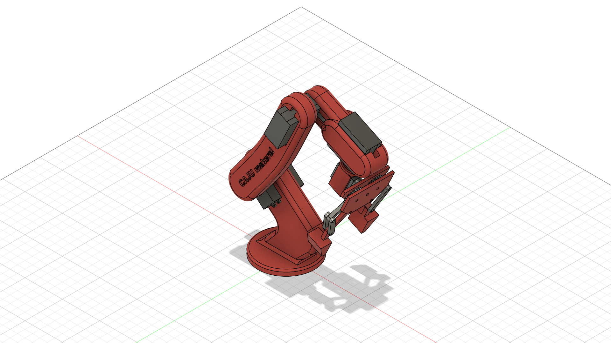

# garra_final — Robot Description



## Overview

| Property | Value |
|----------|-------|
| Total mass | 0.863 kg |
| Links | 21 |
| Joints | 20 (0 movable) |
| Assemblies | 2 |
| Root link | `base_link` |

## Table of Contents

- [Kinematic Tree](#kinematic-tree)
- [Link Properties](#link-properties)
- [Joint Properties](#joint-properties)
- [Assembly Breakdown](#assembly-breakdown)
- [Quick Start (ROS 2)](#quick-start-ros-2)
- [Files](#files)

## Kinematic Tree

```
base_link
  └─ R_gido [fixed]
    shoulder_motor
      └─ R_gido_46 [fixed]
        garra_final_showder_servo_horn
          └─ R_gido_47 [fixed]
            M_dulo_1
              └─ R_gido_48 [fixed]
                MOTOR_1
                  └─ R_gido_49 [fixed]
                    garra_final_showder_servo_horn_2
                      └─ R_gido_50 [fixed]
                        M_dulo_2
                          └─ R_gido_51 [fixed]
                            MOTOR_1_1
                              └─ R_gido_52 [fixed]
                                Caixa_motor_pequeno
                                  └─ R_gido_53 [fixed]
                                    motor_pequeno
                                      └─ R_gido_54 [fixed]
                                        Componente4_Espelhar
                                          └─ R_gido_55 [fixed]
                                            Healical_Gear_20R_0_00_m_1_0
                                              └─ R_gido_59 [fixed]
                                                Componente5_Espelhar_1
                                              └─ R_gido_60 [fixed]
                                                Componente5_Espelhar_Espelhar
                                                  └─ R_gido_61 [fixed]
                                                    Componente6_Espelhar
                                          └─ R_gido_56 [fixed]
                                            Healical_Gear_20R_0_00_m_1_0_1
                                              └─ R_gido_57 [fixed]
                                                Componente5
                                                  └─ R_gido_62 [fixed]
                                                    Componente6
                                              └─ R_gido_58 [fixed]
                                                Componente5_Espelhar
                                              └─ R_gido_64 [fixed]
                                                Componente4
                                          └─ R_gido_63 [fixed]
                                            Healical_Gear_8R_0_00_m_1_0
```

## Link Properties

| Link | Mass (kg) | Material | Collision | Bodies |
|------|-----------|----------|-----------|--------|
| `Caixa_motor_pequeno` | 0.0513 | A_o | box | 1 |
| `Componente4` | 0.0476 | A_o | box | 1 |
| `Componente4_Espelhar` | 0.0267 | A_o | box | 1 |
| `Componente5` | 0.0046 | A_o | box | 1 |
| `Componente5_Espelhar` | 0.0046 | A_o | box | 1 |
| `Componente5_Espelhar_1` | 0.0046 | A_o | box | 1 |
| `Componente5_Espelhar_Espelhar` | 0.0046 | A_o | box | 1 |
| `Componente6` | 0.0391 | A_o | box | 1 |
| `Componente6_Espelhar` | 0.0391 | A_o | box | 1 |
| `Healical_Gear_20R_0_00_m_1_0` | 0.0135 | A_o | box | 1 |
| `Healical_Gear_20R_0_00_m_1_0_1` | 0.0135 | A_o | box | 1 |
| `Healical_Gear_8R_0_00_m_1_0` | 0.0013 | A_o | cylinder | 1 |
| `MOTOR_1` | 0.0892 | Alum_nio_prata_anodizada | cylinder | 1 |
| `MOTOR_1_1` | 0.0892 | Alum_nio_prata_anodizada | cylinder | 1 |
| `M_dulo_1` | 0.0961 | Laminado_vermelho_fosco | box | 1 |
| `M_dulo_2` | 0.0565 | Laminado_vermelho_fosco | box | 1 |
| `base_link` | 0.1225 | Laminado_vermelho_fosco | cylinder | 1 |
| `garra_final_showder_servo_horn` | 0.0072 | A_o | box | 1 |
| `garra_final_showder_servo_horn_2` | 0.0072 | A_o | box | 1 |
| `motor_pequeno` | 0.0557 | A_o | box | 1 |
| `shoulder_motor` | 0.0892 | Alum_nio_prata_anodizada | cylinder | 1 |

## Joint Properties

| Joint | Type | Parent → Child | Axis | Limits |
|-------|------|---------------|------|--------|
| `R_gido` | fixed | `base_link` → `shoulder_motor` | (0,0,1) | — |
| `R_gido_46` | fixed | `shoulder_motor` → `garra_final_showder_servo_horn` | (0,0,1) | — |
| `R_gido_47` | fixed | `garra_final_showder_servo_horn` → `M_dulo_1` | (0,0,1) | — |
| `R_gido_48` | fixed | `M_dulo_1` → `MOTOR_1` | (0,0,1) | — |
| `R_gido_49` | fixed | `MOTOR_1` → `garra_final_showder_servo_horn_2` | (0,0,1) | — |
| `R_gido_50` | fixed | `garra_final_showder_servo_horn_2` → `M_dulo_2` | (0,0,1) | — |
| `R_gido_51` | fixed | `M_dulo_2` → `MOTOR_1_1` | (0,0,1) | — |
| `R_gido_52` | fixed | `MOTOR_1_1` → `Caixa_motor_pequeno` | (0,0,1) | — |
| `R_gido_53` | fixed | `Caixa_motor_pequeno` → `motor_pequeno` | (0,0,1) | — |
| `R_gido_54` | fixed | `motor_pequeno` → `Componente4_Espelhar` | (0,0,1) | — |
| `R_gido_55` | fixed | `Componente4_Espelhar` → `Healical_Gear_20R_0_00_m_1_0` | (0,0,1) | — |
| `R_gido_56` | fixed | `Componente4_Espelhar` → `Healical_Gear_20R_0_00_m_1_0_1` | (0,0,1) | — |
| `R_gido_57` | fixed | `Healical_Gear_20R_0_00_m_1_0_1` → `Componente5` | (0,0,1) | — |
| `R_gido_58` | fixed | `Healical_Gear_20R_0_00_m_1_0_1` → `Componente5_Espelhar` | (0,0,1) | — |
| `R_gido_59` | fixed | `Healical_Gear_20R_0_00_m_1_0` → `Componente5_Espelhar_1` | (0,0,1) | — |
| `R_gido_60` | fixed | `Healical_Gear_20R_0_00_m_1_0` → `Componente5_Espelhar_Espelhar` | (0,0,1) | — |
| `R_gido_61` | fixed | `Componente5_Espelhar_Espelhar` → `Componente6_Espelhar` | (0,0,1) | — |
| `R_gido_62` | fixed | `Componente5` → `Componente6` | (0,0,1) | — |
| `R_gido_63` | fixed | `Componente4_Espelhar` → `Healical_Gear_8R_0_00_m_1_0` | (0,0,1) | — |
| `R_gido_64` | fixed | `Healical_Gear_20R_0_00_m_1_0_1` → `Componente4` | (0,0,1) | — |

## Assembly Breakdown

### Nova_Pin_a

- **Links**: Healical_Gear_20R_0_00_m_1_0, Healical_Gear_20R_0_00_m_1_0_1, Healical_Gear_8R_0_00_m_1_0, Componente4, Componente5, Componente6, Componente5_Espelhar, Componente5_Espelhar_1, Componente6_Espelhar, Componente5_Espelhar_Espelhar, Componente4_Espelhar
- **Total mass**: 0.199 kg

### garra_final

- **Links**: motor_pequeno, M_dulo_1, MOTOR_1, M_dulo_2, MOTOR_1_1, garra_final_showder_servo_horn, base_link, Caixa_motor_pequeno, shoulder_motor, garra_final_showder_servo_horn_2
- **Total mass**: 0.664 kg

## Quick Start (ROS 2)

```bash
# 1. Copy package to your ROS 2 workspace
cp -r garra_final_description ~/ros2_ws/src/

# 2. Build
cd ~/ros2_ws
colcon build --packages-select garra_final_description
source install/setup.bash

# 3. Visualize in RViz2
ros2 launch garra_final_description display.launch.py

# 4. Validate URDF structure
check_urdf install/garra_final_description/share/garra_final_description/urdf/garra_final.urdf

# 5. Print kinematic tree
urdf_to_graphviz install/garra_final_description/share/garra_final_description/urdf/garra_final.urdf
```

**Joint control**: The launch file includes `joint_state_publisher_gui` —
use the sliders to move revolute/prismatic joints in RViz2.

**Topic inspection**:
```bash
# See published joint states
ros2 topic echo /joint_states

# See robot description parameter
ros2 param get /robot_state_publisher robot_description
```

## Files

| Path | Description |
|------|-------------|
| `urdf/garra_final.urdf.xacro` | Top-level xacro (entry point) |
| `urdf/garra_final.urdf` | Flat URDF (for validation) |
| `urdf/assemblies/` | Per-assembly xacro macros |
| `meshes/` | Visual (OBJ) and collision (STL) meshes |
| `launch/display.launch.py` | Launch robot_state_publisher, RViz, and generated controllers |
| `config/joint_state.yaml` | Joint state publisher config |
| `robot_data.yaml` | Supplementary data (beyond URDF) |
| `docs/transforms.md` | Transformation matrices (KaTeX) |

## Customizing

Assemblies tagged `!dummy_` are designed to be swapped out. To replace one:

1. Create your replacement as a xacro macro with the same interface
2. Place it in `urdf/assemblies/`
3. Update the `<xacro:include>` in `urdf/garra_final.urdf.xacro`
4. Update meshes in `meshes/<your_assembly>/`

The xacro prefix system (`${prefix}`) ensures link names stay unique
when multiple instances of the same assembly are used.

---
*Generated by Fusion URDF/XACRO Exporter v3.1.1*